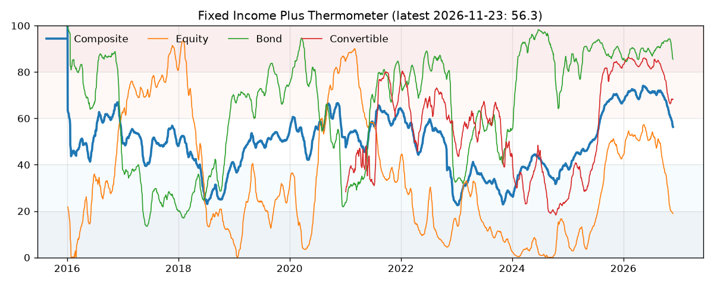

# 固收+ 多资产温度计 · 2026-11-23

**综合温度：56.3（中性）**　20个交易日前：63.2

温度 0–100，越高越贵 / 越拥挤 / 未来预期回报越低。

| 资产 | 温度 | 状态 |
|---|---|---|
| 股票 | 19.0 | 极冷 |
| 纯债 | 85.5 | 过热 |
| 转债 | 68.2 | 偏热 |
| 均值回归(偏债混基) | 52.2 | 中性 |
| 股债相对温度（股−债） | -66.5 | 股票相对便宜 |

## 因子明细

| 因子 | 原始值 | 温度 |
|---|---|---|
| 股权风险溢价 ERP | 3.61 | 27.6 |
| 股债利差(股息率−10Y) | 1.42 | 10.4 |
| 10Y国债收益率 | 1.58 | 100.0 |
| 10Y−7天逆回购 | 0.19 | 95.3 |
| 信用利差 | 29.88 | 59.5 |
| 等级利差 AA+−AAA | 6.00 | 85.7 |
| 转股溢价率 | 41.03 | 89.4 |
| 偏债混基3年年化 | 3.16 | 52.2 |

数据来源于万得 Wind 金融数据服务。
